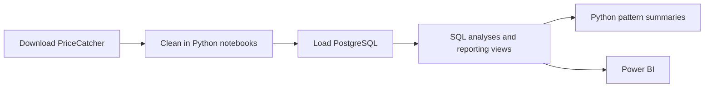
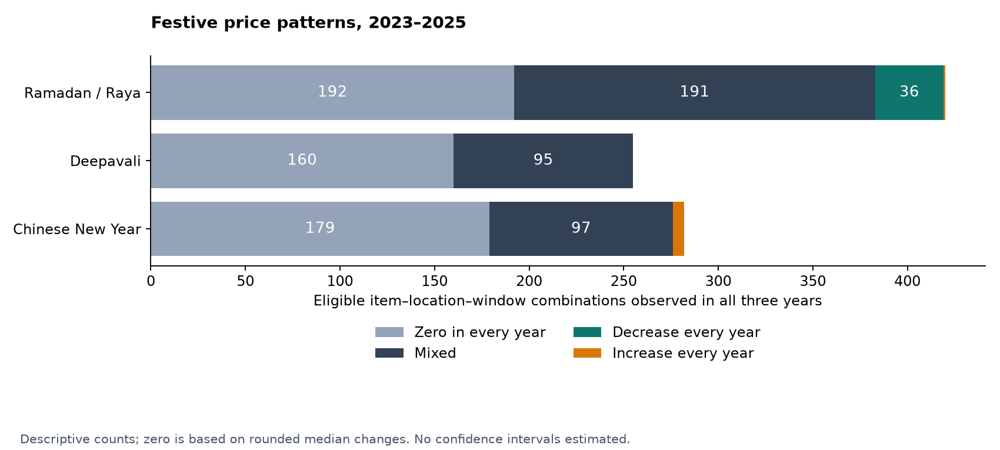
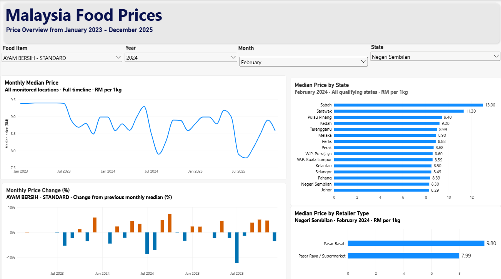
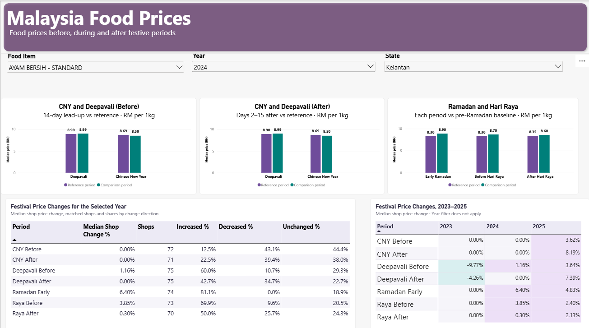

# Malaysia Food Prices Around Festive Periods

Analysis of how staple food prices in Malaysia move around festive periods, by state and premise type, using PriceCatcher open data.

[Power BI dashboard](dashboard/price_catcher_visual.pbix) · [Dashboard screenshots](#dashboard) · [Results chart](docs/images/festival-patterns.png) · [Analysis notes](docs/analysis_findings.md) · [Reproduction guide](docs/reproduction.md)

## Key findings

- **No consistent increase across most comparisons:** 531 of 957 eligible combinations had a reported median change of 0% in every year; 383 had mixed patterns. Statistical uncertainty was not estimated. **Recommendation:** avoid a blanket “buy before festivals” rule.
- **Tomatoes fell around Raya:** decreases occurred in all three years in 13 of 15 eligible locations during the lead-up, and 14 of 15 afterward. These are descriptive counts, with no confidence interval. **Recommendation:** check the item and local market before changing purchase timing.
- **Tomato increases were sensitive to coverage:** the May–June 2024 matched-shop median increase was 79.03%, versus 96.99% under stricter date coverage (a sensitivity span of 79.03–96.99%, not a confidence interval). **Recommendation:** report coverage checks alongside headline changes.
- **Flagged prices had little influence on festive medians:** 2 of 3,259 comparisons changed when flags were excluded; absolute changes ranged from 0 to 0.89 percentage points, with no direction reversals. This is a sensitivity range, not inferential uncertainty. **Recommendation:** retain flags and show the sensitivity analysis.

Evidence: [three-year summary](docs/festival_three_year_summary.csv), [matched tomatoes](docs/tomato_matched_premises_2024_05_06.csv), [tomato sensitivity](docs/tomato_coverage_sensitivity_2024_05_06.csv), and [flag sensitivity query](sql/11_festival_price_sensitivity.sql).

## Question and motivation

How do prices of selected staple foods change before and after Chinese New Year,
Ramadan/Aidilfitri and Deepavali, and how do observed prices differ by state and premise type?

Consumers can use local comparisons to inform shopping; analysts and retailers can
use the coverage audits to distinguish observed patterns from weakly supported comparisons.
The project examines monitored prices, not household expenditure or festival causation.

## Data

Source: [PriceCatcher transactional records](https://data.gov.my/data-catalogue/pricecatcher),
[item lookup](https://data.gov.my/data-catalogue/lookup_item), and
[premise lookup](https://data.gov.my/data-catalogue/lookup_premise), credited to KPDN and DOSM.
The source data is licensed under [CC BY 4.0](https://creativecommons.org/licenses/by/4.0/).

- Main analysis: January 2023–December 2025.
- Supporting period: 25–31 December 2022, for the Chinese New Year 2023 reference window.
- August–September 2026 files support exploratory basket inspection only.
- Source monthly files scanned: **87,081,467 rows** across December 2022–December 2025.
- After item/date selection: **6,945,359 rows**; after removing 31 duplicates: **6,945,328 rows**.
- Final total includes **30,247 supporting-period rows**; **6,915,081 rows** fall in 2023–2025.

Counts: [extraction log](docs/basket_extraction_log.csv) and [deduplication log](docs/basket_deduplication_log.csv).

| Code | Selected product | Unit |
|---|---|---|
| 1 | Standard cleaned chicken | 1 kg |
| 1111 | Grade C eggs | 30 eggs |
| 904 | Cap Rambutan imported rice, 5% | 10 kg |
| 918 | Packet cooking oil, assorted brands | 1 kg |
| 1589 | Coarse refined white sugar, assorted brands | 1 kg |
| 917 | Cap Sauh NGP wheat flour | 1 kg |
| 129 | Yellow/Holland onions | 1 kg |
| 1564 | Imported Chinese garlic | 1 kg |
| 1131 | Imported Chinese potatoes | 1 kg |
| 94 | Red chilli, minyak variety | 1 kg |
| 114 | Tomatoes | 1 kg |
| 103 | Fresh coconut milk, regular | 1 kg |
| 1431 | Local beef thigh cut, excluding tenderloin | 1 kg |
| 1555 | Farmed white/vannamei prawns, 41–60 per kg | 1 kg |
| 193 | King Cup sardines in tomato sauce | 425 g |

Exact source labels: [basket summary](docs/basket_price_summary_2023_2025.csv).
Products and units remain separate; there is no consumption-weighted basket index.
PriceCatcher is surveillance data, not CPI. Premise-by-item coverage is uneven;
the item and premise lookups may not reflect historical changes.

## Architecture



The implementation has a fact table and two lookup dimensions:

- `price_observations`: one row per date, premise and item; prices and quality flags.
- `items`: product names, units and classifications, keyed by `item_code`.
- `premises`: location, retailer type and lookup status, keyed by `premise_code`.
- `festival_windows`: a separate calendar table, joined by inclusive date ranges.

[Schema](sql/01_create_tables.sql) · [Reporting views](sql/12_reporting_views.sql)

## Cleaning

| Rule | Reason | Recorded impact |
|---|---|---|
| Select the basket and date range | Keep a defined scope | 87,081,467 → 6,945,359 rows |
| Remove exact duplicate observations | Avoid counting the same observation twice | 31 removed; 6,945,328 retained |
| Audit missing keys/prices, non-finite and non-positive prices | Identify unusable observations | 0 found in the selected-data audit |
| Trim premise-type whitespace | Combine labels differing only in whitespace | 338 lookup labels changed; 0 rows removed |
| Flag price/median ratios below 0.2 or above 5 | Review unusual prices without assuming error | 587 flagged; 0 automatically removed |
| Preserve unmatched premise records | Avoid inventing locations or retailer types | 21 retained; unavailable for geographic comparisons |
| Review recurring low-price clusters | Separate possible promotions from proven errors | 270 reviewed and retained; 0 prices changed |

Details: [cleaning log](docs/cleaning_log.md), [quality audit](docs/basket_quality_audit.csv),
and [lookup-join audit](docs/basket_lookup_join_audit.csv).

## Method

All festive windows have inclusive boundaries and span 14 days.

| Festival | Reference | Target windows |
|---|---|---|
| Chinese New Year / Deepavali | Days −28 to −15 | Lead-up −14 to −1; after +2 to +15 |
| Ramadan / Aidilfitri | 14 days before the first fasting day | First 14 fasting days; 14 days before Raya; +2 to +15 after Raya |

Days 0 and +1 are excluded from the post-festival comparisons.
The Raya reference remains pre-Ramadan; it is not late Ramadan.
[Calendar](docs/festival_calendar.csv) · [Exact windows](docs/festival_windows_candidate.csv)

For each item, state and window pair, match premises observed in both windows.
Compute each shop's median price in each window, then calculate:

`shop change (%) = 100 × (target median − reference median) / reference median`

Report the median of these shop changes, giving each matched shop equal weight.
Require at least 5 matched premises and 4 distinct observed dates per window
collectively across matched premises; the date rule is not per shop.
Insufficient coverage means unavailable, not zero.

Monthly state comparisons require at least 5 premises and 4 dates per group.
Retailer comparisons use the same item, state and month, with at least 2 eligible types.
Monthly medians pool observations; they are distinct from the festive matched-shop metric.

**Inference:** no confidence intervals, hypothesis tests or multiple-comparison
adjustments are implemented in the saved analysis. Findings are descriptive;
zero or mixed patterns are not statistical proof of no effect.

**Decision timing:** [decisions.md](docs/decisions.md) records candidate windows and
coverage rules as proposed before price-effect analysis. It remains a provisional
decision record, not evidence of a fully locked or preregistered statistical plan.
The tomato case study was selected after reviewing monthly changes.

## Results



| Festival | Zero each year | Mixed | Decrease each year | Increase each year | Total |
|---|---:|---:|---:|---:|---:|
| Chinese New Year | 179 | 97 | 0 | 6 | 282 |
| Deepavali | 160 | 95 | 0 | 0 | 255 |
| Ramadan / Raya | 192 | 191 | 36 | 1 | 420 |
| Total | 531 | 383 | 36 | 7 | 957 |

Each count represents an item–location–target-window combination qualifying in all
three years. Classification uses exported changes rounded to two decimal places.
Matched shops may differ between years. Confidence intervals are not available.

**What this shows:** recurring direction is item-specific. For example, prawns rose
after Chinese New Year in all three years in 5 of 15 eligible locations.
Deepavali has no combination with a non-zero direction repeated in every year.
**What it does not show:** that festivals caused the changes, or that every shop
was unchanged when a group median was zero. Seasonality, supply and policy can matter.

[Annual estimates and coverage](docs/festival_price_comparison_2023_2025.csv) ·
[Three-year detail](docs/festival_three_year_patterns.csv)

For standard chicken in December 2025, eligible state medians ranged from RM8.20/kg
in Johor (178 premises) to RM12.89/kg in Sabah (18 premises). This is an observed
range, not a confidence interval or a cost-of-living comparison.

Within Johor in the same month:

| Premise type | Median RM/kg |
|---|---:|
| Hypermarket | 7.95 |
| Supermarket | 8.09 |
| Mini market | 8.60 |
| Grocery shop | 9.20 |
| Wet market | 9.60 |

**What this shows:** a within-state, same-item comparison of observed prices.
**What it does not show:** a permanent retailer ranking; districts, shop composition
and monitoring frequency differ. No confidence intervals were calculated.
Beef had no qualifying multi-retailer comparison under these coverage rules.

[State comparisons](docs/monthly_state_price_ranks_2023_2025.csv) ·
[Premise-type comparisons](docs/monthly_retailer_price_comparison_2023_2025.csv) ·
[Interpretation and sensitivity results](docs/analysis_findings.md)

## Dashboard

Download [price_catcher_visual.pbix](dashboard/price_catcher_visual.pbix) and open it
with [Power BI Desktop for Windows](https://learn.microsoft.com/en-us/power-bi/fundamentals/desktop-get-the-desktop).
The report contains **Price Overview** and **Festival Analysis** pages.
GitHub stores the file but does not provide an interactive Power BI viewer.
For refresh, configure local source connections in Data source settings;
saved source paths and credentials are machine-specific.
**Price Overview:** monthly trends and changes, state comparisons, and retailer-type comparisons. Shown: standard chicken, February 2024, Negeri Sembilan; the timeline covers all monitored locations.



**Festival Analysis:** reference-versus-comparison prices, matched-shop changes and coverage, and patterns across years. Shown: standard chicken in Kelantan, with 2024 selected; the three-year table ignores the year filter.



## Limitations

- Monitoring coverage is uneven and not a representative household spending sample.
- Historical lookup changes and sparse item–premise coverage limit comparability.
- Window definitions and overlapping festivals can affect the comparison.
- Matching shops does not control for policy changes, promotions or supply shocks.
- Three years and descriptive medians support no causal or significance claims.

## How to reproduce

Use Python, PostgreSQL with `psql`, and Power BI Desktop on Windows for the report.
Install [requirements.txt](requirements.txt), download source Parquet files, then run
the notebooks, loaders and SQL in the order in the [reproduction guide](docs/reproduction.md).
That guide includes database variables, commands and CSV export instructions.

The inspected local raw folder occupies about 120 MB and the 37 prepared files
about 49 MB (decimal units); staging, database storage and memory require more.
Runtime has not been benchmarked. Package versions are not pinned.
The database loader checks for 6,945,328 rows and refuses to append to non-empty tables.
No automated test suite or CI workflow is included, so no CI badge is displayed.

## Repo structure

Top-level published structure (directory contents are summarized):

```text
malaysia-food-prices/
├── .gitignore
├── LICENSE
├── README.md
├── requirements.txt
├── dashboard/       # price_catcher_visual.pbix
├── docs/            # decisions, audits, CSV results and reproduction.md
│   └── images/      # results chart and dashboard screenshots
├── notebooks/       # 01_data_inspection, 02_coverage_checks, 03_data_preparation
├── sql/             # 01_create_tables.sql through 12_reporting_views.sql
└── src/             # environment checks, loaders and pattern summaries
```

Local `.env`, `data/`, environments and checkpoints are ignored and not published.

## Next steps

Possible extensions: estimate uncertainty using an appropriate clustered resampling
design, prespecify multiple-comparison handling, and test alternative window definitions.
Possible extension: forecast monthly prices vs a seasonal-naive baseline.

## Credits and licence

Data: KPDN and DOSM via data.gov.my, under CC BY 4.0; this project filters,
cleans and summarizes their records. Code: [MIT License](LICENSE).
This is an independent analysis project, not an official price index or agency endorsement.
